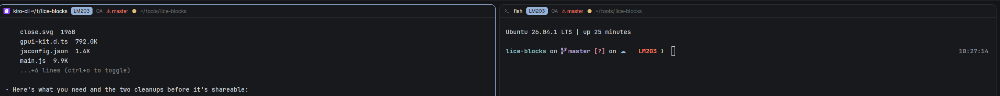

# LiCE Pane Header (Herdr mod)

A [Herdr](https://herdr.dev) pane header for panes working inside a
[LiCE](https://lice.tools) project (a folder with `.nitconfig.json`). It adds
a strip to each pane header showing the selected **Nit id** (click it to open
the Nit in the browser), its **workflow stage**, the **git branch** (flagged
in red with ⚠ when the checkout isn't on the Nit's branch), and a
**branch-status glyph** (✓ clean · ● dirty · ↑/↓/↕ ahead/behind/diverged).

Public repo, but intentionally **not listed on herdr.dev/mods** (no
`herdr-mod` topic) — install it by cloning this repo
(see [Install](#install)).



Outside a LiCE project the header behaves exactly like Herdr's shipped `pane`
header and shows no strip.

## Install

This mod is **not** listed on herdr.dev/mods (by design — no `herdr-mod`
topic). Install it straight from this repo:

```sh
# 1. Get the mod into your Herdr mods folder (clone anywhere, then copy the folder in):
git clone <this-repo-url> /tmp/herdr-lice-pane
cp -R /tmp/herdr-lice-pane/mods/lice-pane ~/.config/herdr-app/mods/

# 2. Check it loads:
herdr-app check ~/.config/herdr-app/mods/lice-pane
```

Or, if you keep a checkout of this repo, symlink it so `git pull` updates the
mod in place:

```sh
git clone <this-repo-url> ~/src/herdr-lice-pane
ln -s ~/src/herdr-lice-pane/mods/lice-pane ~/.config/herdr-app/mods/lice-pane
herdr-app check ~/.config/herdr-app/mods/lice-pane
```

Then use it in a layout's pane frame. The shipped layouts are read-only, so
clone one and point its pane header at the mod:

```sh
herdr-app do layout.clone '{"name":"main","as":"lice"}'
```

Edit `~/.config/herdr-app/layouts/lice.json` and set the tab block's
`pane.header.content.mod` to `"lice-pane"` (it's under
`children → work → work-body → main → content → pane → header → content`).
`layout.clone` switches to the new layout; `ctrl-shift-l` cycles back to
`main`. The `lice` layout is yours and survives restarts.

> Keep the `herdr-mod` topic OFF this repo: that topic is the only thing that
> lists a repo on herdr.dev/mods. Without it the repo is public and cloneable
> but never surfaces in the Herdr directory. The mod installs the same either
> way — the topic only controls the public listing.

## What it reads (and runs)

Per LiCE-enabled pane, on a gentle 4s timer, in the pane's folder on the
pane's machine:

- `readTextFile(".nit.local.json")` → the selected Nit id.
- `nit status --verbose` → the stage and the Nit's recorded branch.
- `git branch --show-current` and `git status --porcelain=v2 --branch` → the
  current branch and clean/dirty/ahead/behind.

Clicking the Nit chip runs `nit web <id>`. It runs the `nit` and `git` CLIs
via Herdr's `exec`; it makes no network calls of its own (`nit` talks to the
LiCE server itself). It reads `.nitconfig.json`/`.nit.local.json` and runs
`git`/`nit` only inside the pane's own repo folder.

## Build it from scratch

See [`RECIPE.md`](RECIPE.md) — the full brief another agent can build this
from with an empty folder.

## Requirements

- Herdr (herdr-app + herdr-core).
- The `nit` CLI on PATH, in a LiCE-attached repo (`.nitconfig.json`).
- Uses the shipped `workspace-chrome` mod's spinner asset (present on every
  Herdr install).
