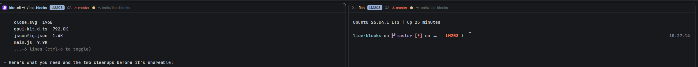

# LiCE Pane Header

A pane header for agent/terminal panes that sit inside a LiCE-enabled project
(a folder with `.nitconfig.json`). On top of the normal pane header — program
icon, title, folder, agent status, split/zoom/close buttons — it adds a LiCE
strip: the **selected Nit's id and workflow stage**, the **git branch**, a
**branch-match warning** when the checkout isn't on the Nit's branch, and a
small **branch-status icon** (clean / dirty / ahead / behind / diverged). An
operator glancing at a pane sees at once which Nit it's for, whether it's on
the right branch, and whether the tree is clean.



It is a drop-in replacement for the shipped `pane` header mod, used by a
layout's pane frame (`{ "tab": "active", "pane": { "header": { "content":
{ "mod": "lice-pane" } } } }`). Outside a LiCE project it behaves exactly
like the shipped header and shows no LiCE strip.

## What you see

One horizontal header bar per pane, full width, 30px tall by default (the
pane frame's `header.height`), 10px horizontal padding, 8px gaps,
`background` fill with a 1px bottom `border`. Text 12px. Left to right:

1. **Program icon** — the pane's program glyph (`svg` for a tinted
   one-colour glyph in `dim`, `image` for a picture), 14px. Omitted when the
   program has no icon.
2. **Name** — the agent's or shell's program name, else the terminal title,
   else `"shell"`. `foreground`, `font_medium`, truncated, max 260px wide.
3. **LiCE strip** (only inside a LiCE project — see below). This is the new
   part. It sits between the name and the folder.
4. **Folder** — the pane's live folder with `~` for home, `flex_1` so it
   takes the slack, `dim`, truncated.
5. **Agent status** — identical to the shipped header: a spinning ring
   (`working`, in `working`), a "Needs you" pill (`blocked`, `blocked`
   colour on a 15%-alpha tint), a 7px dot (`done`, in `done`), nothing when
   `idle`.
6. **Buttons** — on hover only: split-right, split-down, zoom/unzoom,
   close. Same four as the shipped header, same icons and commands.

### The LiCE strip, left to right

- **Nit chip** — `LM203` in `accent_foreground` on an `accent`-tinted
  rounded chip (radius 5, ~6px horizontal padding, 18px tall, 11px
  semibold). The id comes from `.nit.local.json`'s `selectedNit`. It's
  **clickable** — pointer cursor, lightens on hover — and opens the Nit in
  the browser (`nit web <id>`). When no Nit is selected the chip reads `—`
  in `dim` on a `raised` background (not clickable).
- **Stage** — the Nit's workflow stage as a small uppercase-ish label next
  to the chip (`QA`, `In Progress`, `Code Review`, …), 10.5px, `dim`. From
  `nit status --verbose` (`Stage:`). Hidden when unknown.
- **Branch** — the current checkout branch (`git branch --show-current`),
  11.5px, truncated, max ~200px. Colour depends on the match:
  - On the Nit's branch → `dim` (normal).
  - **Not** on the Nit's branch → `blocked` colour, prefixed with a small
    warning glyph (`⚠`), so a mismatch is obvious. The Nit's branch is the
    `Branch:` line from `nit status --verbose` (its recorded branch
    affinity). If there's no selected Nit or no recorded branch, the branch
    is drawn `dim` with no warning (nothing to mismatch against).
- **Branch-status icon** — a single glyph + optional count summarising the
  working tree against upstream, from `git status --porcelain=v2 --branch`:
  - **clean** (no changes, level with upstream) → `✓` in `done`.
  - **dirty** (any staged/unstaged/untracked entry) → `●` in `working`;
    when it's also ahead/behind the arrows follow.
  - **ahead** `↑N` in `accent`, **behind** `↓N` in `idle`/`dim`,
    **diverged** `↕` with both counts in `blocked`.
  - Order: dirty dot first (if dirty), then ahead/behind arrows. A clean,
    level tree is just `✓`.

Everything in the strip has a tooltip-free, compact look; the whole strip
is omitted when the pane is not inside a LiCE project.

## How it behaves

- **Which pane** — the mod finds its own pane with
  `panes().find(p => p.pane === props().pane)`, exactly like the shipped
  header. It reads that pane's live `cwd`, `branch`, `status`, `program`,
  `title`, `zoomed`. It never acts on the focused pane.
- **LiCE detection** — a pane is LiCE-enabled when `<cwd>/.nitconfig.json`
  exists. The mod walks up from `cwd` to find the repo root the same way git
  does is unnecessary: it checks `cwd` and its ancestors up to `~` for
  `.nitconfig.json` (a pane deep in a subfolder still counts). Detection is
  by **file presence**, not by a command exit code (`nit status` outside a
  project exits 0 with a "No server configured" message, so exit code is not
  a signal).
- **Reading LiCE state** — per LiCE-enabled pane the mod runs, in the pane's
  folder and on the pane's machine (`exec(..., { cwd, on: pane.machine })`):
  - `readTextFile("<root>/.nit.local.json", { on })` → parse JSON →
    `selectedNit`.
  - `nit status --verbose` → parse the `Key: value` lines
    (`Stage:`, `Branch:`, `Current:`). Output is plain text — there is **no**
    `--json`. Parse line by line, trimming; tolerate missing lines.
  - `git branch --show-current` → current branch.
  - `git status --porcelain=v2 --branch` → the `# branch.ab +A -B` line for
    ahead/behind, and whether any non-`#` line exists for dirty.
- **Freshness** — results are cached per pane and refreshed on a gentle
  timer (`cx.timer.every(4000, …)`) and whenever the pane's `cwd`/`branch`
  changes between renders (a cheap compare in `render`). `nit status` hits
  the network, so do not refresh faster than a few seconds, and never in
  `render`. While a pane's first read is in flight show the chip as `…`.
- **Clicks / hovers** — clicking the header focuses the pane
  (`run("pane.focus", { pane })`), like the shipped header. The four
  action buttons appear on hover and run `pane.split` / `pane.zoom` /
  `pane.close` with this pane, stopping propagation so they don't also
  focus. **The Nit chip is clickable**: it shows a pointer cursor, lightens
  to `solid` on hover, and on click runs `nit web <nitId>` via
  `exec("nit", ["web", nitId], { cwd, on })` in the pane's folder on its
  machine (so the right project/auth is used), opening the Nit in the
  browser. It stops propagation so the click doesn't also focus the pane.
- **Theme** — every colour is a `theme()` name so it follows the user's
  theme in light and dark: `background`, `border`, `foreground`, `dim`,
  `accent`, `accent_foreground`, `raised`, `done`, `working`, `blocked`,
  `idle`, `hover`.

## Built from

- **A mod**, `mods/lice-pane/`, cloned from the shipped `pane` header mod
  as the starting point (`herdr-app do mod.clone '{"name":"pane","as":"lice-pane"}'`),
  then extended. It is a **pane header**, so `mod.json` is
  `{ "place": "none", "title": "LiCE pane header" }` (headers are placed by
  a layout's pane frame, never docked on their own).
- **Used by a layout's pane frame.** It is not referenced by the shipped
  read-only layouts. To use it, clone a layout and point its tab block's
  `pane.header.content.mod` at `lice-pane`:
  ```json
  { "tab": "active",
    "pane": { "gap": 6, "radius": 6, "background": "surface",
              "border": { "width": 1, "color": "border" },
              "focus": { "width": 1, "color": "accent" },
              "header": { "content": { "mod": "lice-pane" },
                          "height": 30, "position": "top", "reveal": "always" },
              "lone": true } } }
  ```
  `lone: true` so even a single-pane tab (the common agent case) gets the
  header. One header copy is drawn per pane with `props().pane` and
  `props().terminal`.
- **`herdr` functions:** `panes()` (find own pane, read `cwd`/`branch`/
  `status`/`program`/`title`/`zoomed`/`pane`), `props()` (`pane`,
  `terminal`), `theme()`, `home()` (for the `~` folder label and the ancestor
  walk stop), `run()` (`pane.focus`, `pane.split`, `pane.zoom`,
  `pane.close`), `readTextFile(path, { on })` (`.nit.local.json`),
  `exec(cmd, args, { cwd, on })` (git + nit), `svg()` / `image()` (icons).
- **gpui-kit / gpui-base:** `View`, `div`, `svg`, `image`; `h_flex`.
  Builders: `.id`, `.size_full`, `.px`, `.gap`, `.items_center`, `.bg`,
  `.border_b`/`.border_color`, `.text_size`, `.text_color`, `.font_medium`/
  `.font_semibold`, `.rounded`, `.truncate`, `.max_w`, `.flex_1`,
  `.flex_none`, `.child`/`.children`, `.when`, `.hover`, `.on_hover`,
  `.on_click`, `.spin(900)` (the working ring).
- **Programs it runs:** `git` (`branch --show-current`,
  `status --porcelain=v2 --branch`) and `nit` (`status --verbose`), both via
  `exec` in the pane's folder on the pane's machine. No network calls from
  the mod itself; `nit status` reaches the LiCE server on its own.
- **Art:** reuses the shipped `pane` mod's button icons
  (`mods/lice-pane/split-right.svg`, `split-down.svg`, `zoom.svg`,
  `unzoom.svg`, `close.svg` — copied by the clone) and the working ring
  `mods/workspace-chrome/spinner.svg`. The chip, warning glyph and
  branch-status marks are text glyphs (`⚠`, `✓`, `●`, `↑`, `↓`, `↕`), no
  new SVGs required.

### Parsing notes (for the build)

- `.nit.local.json` shape used: `{ "selectedNit": "LM203", ... }`. Only
  `selectedNit` is read. It may be `null` or the file absent → no Nit.
- `.nitconfig.json` shape: `{ "projectId": "...", "baseBranch": "...",
  "server": "..." }`. Only its **presence** matters for detection; the mod
  doesn't need its contents, but may read `projectId` for a tooltip later.
- `nit status --verbose` lines of interest (two-space-indented,
  `Key:` then whitespace then value):
  ```
  LM203: <title>
    Stage:     QA
    Branch:    nit/lm203-e2e-store-cleanup   ← the Nit's recorded branch
    Current:   master                         ← the checkout now
  ```
  Branch mismatch = `Current` (or `git branch --show-current`) differs from
  `Branch`. Prefer `git branch --show-current` for the live current branch
  (it's cheaper and always present) and use the parsed `Branch:` for the
  Nit's branch.
- `git status --porcelain=v2 --branch`:
  ```
  # branch.ab +0 -0    ← ahead +A, behind -B
  1 .M ...             ← any line not starting with '#' ⇒ dirty
  ? path               ← untracked ⇒ dirty
  ```

## Watch out

- **`nit status` has no `--json`.** Parse the plain text defensively: match
  on the leading `Stage:` / `Branch:` / `Current:` tokens after trimming,
  don't assume column positions or line order, and tolerate extra lines
  (Readiness, Score, Origin, Target) and missing ones.
- **Detection is file-presence, not exit code.** `nit status` outside a LiCE
  project exits 0 and prints "No server configured". Check for
  `.nitconfig.json` up the tree from `cwd`; only then run `nit`.
- **Don't run commands in `render`.** `render` runs on every window redraw
  and every live-data change. Do all `exec`/`readTextFile` in `init` and a
  `cx.timer.every(4000, …)` tick (and an explicit refresh when the pane's
  `cwd`/`branch` changed), caching into `this`. A per-render `exec` would
  spawn git/nit on every frame.
- **Refresh gently.** `nit status` is a network call. 4s is fine; faster is
  wasteful. Every mod copy (one per pane) polls independently, so keep the
  work small and bail early when the pane isn't LiCE-enabled.
- **Per-machine folders.** A pane can be on another machine; always pass
  `on: pane.machine` to `exec`/`readTextFile` and use the pane's `cwd`, not a
  local path. `readTextFile` with `on` reads the remote file.
- **Mod pane headers** — a mod pane (`pane.split { mod }`) has
  `terminal: null` and no meaningful `cwd` for git. Guard: if there's no
  `cwd`, skip the LiCE strip and just draw name/status like the shipped
  header.
- **Space `branch` vs pane `branch`.** `SpaceInfo.branch` is the space's
  first terminal's branch; use the **pane's** own `cwd`/`branch` here — a
  split can have several panes on different branches.
- **Width.** Inside a 30px header the strip must stay compact: chip + short
  stage + truncated branch + one status glyph. Truncate the branch (max
  ~200px) and the name (max 260px) so the folder keeps its `flex_1` slack;
  on a narrow pane the folder truncates first, then the branch.
- **No clone of the shipped mod in place.** `pane` is a shipped read-only
  mod; edit the **clone** (`lice-pane`), never `mods/pane/` (the app
  restores it on next start).
- **One cross-mod asset.** The `working` spinner reuses the shipped
  `mods/workspace-chrome/spinner.svg` (via `svg("mods/workspace-chrome/
  spinner.svg").spin(900)`). That mod ships with every Herdr install, so the
  dependency is safe, but it means the spinner only draws where
  `workspace-chrome` exists. To be fully self-contained, drop your own
  `spinner.svg` into `mods/lice-pane/` and reference that instead. The four
  button icons ARE self-contained (`mods/lice-pane/*.svg`).
- **The chip runs `nit web`.** Clicking the Nit chip opens the Nit in the
  browser via `exec("nit", ["web", nitId], { cwd, on })` — `cwd` is the
  pane's folder and `on` its machine, so a remote pane opens the browser on
  that machine (its default handler), not locally. The chip needs an
  `.id()` (e.g. `lice-chip-<pane>`) to be interactive, and must
  `cx.stop_propagation()` in its click so it doesn't also focus the pane.
  The `exec` runs in a `cx.spawn` and swallows errors (a missing `nit` or a
  headless machine shouldn't crash the header).

## Done when

- `herdr-app check ~/.config/herdr-app/mods/lice-pane` passes (loads and
  renders once with no error).
- Pointed at a pane whose `cwd` is a LiCE project (e.g. one with
  `.nitconfig.json` and `.nit.local.json` holding `selectedNit: "LM203"`),
  the header shows the `LM203` chip and the stage from `nit status
  --verbose`.
- When the pane's checkout is **not** on the Nit's `Branch:` (e.g. on
  `master` while the Nit's branch is `nit/lm203-…`), the branch is drawn in
  the `blocked` colour with the `⚠` warning glyph; when it **is** on the
  Nit's branch the branch is `dim` with no warning.
- A clean, level tree shows `✓` (`done`); after editing a tracked file the
  status icon switches to the dirty dot `●`; with commits ahead of upstream
  it shows `↑N`; behind shows `↓N`.
- In a pane whose `cwd` has **no** `.nitconfig.json` (or a mod pane with no
  `cwd`), no LiCE strip is drawn and the header matches the shipped `pane`
  header (icon, name, folder, status, hover buttons).
- The four hover buttons still split-right, split-down, zoom/unzoom and
  close this pane, and clicking the bar focuses the pane.
- Clicking the Nit chip opens the Nit in the browser (`nit web <id>`), and
  the click does not also focus/disturb the pane.
- Reads happen off `render` (a timer), not on every frame, and every `exec`/
  `readTextFile` passes `on: pane.machine`.
